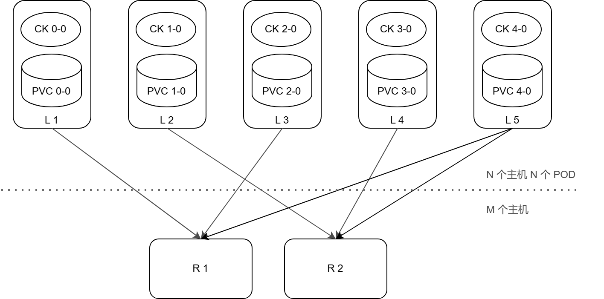
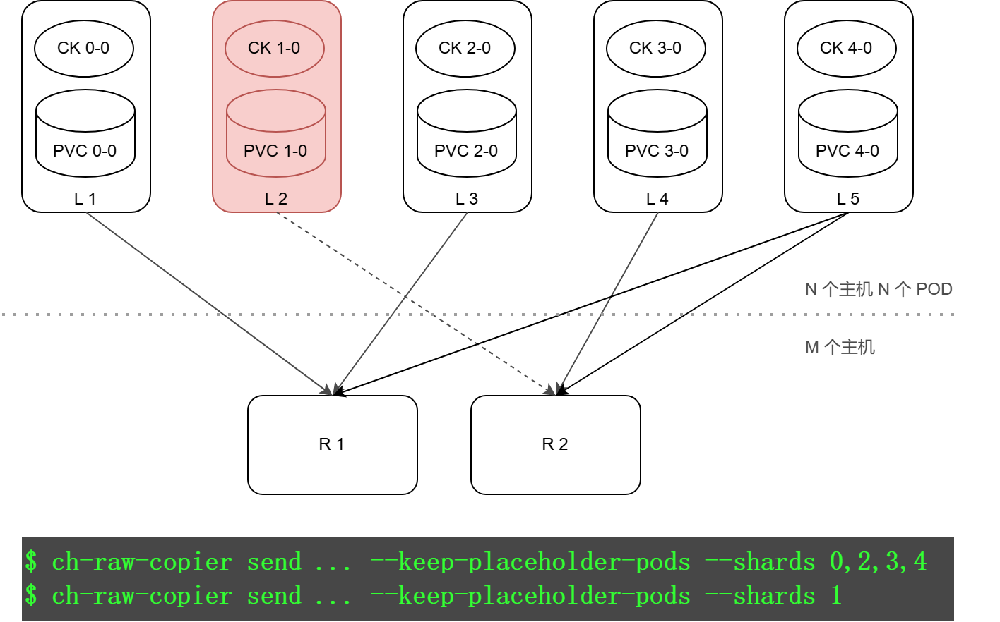
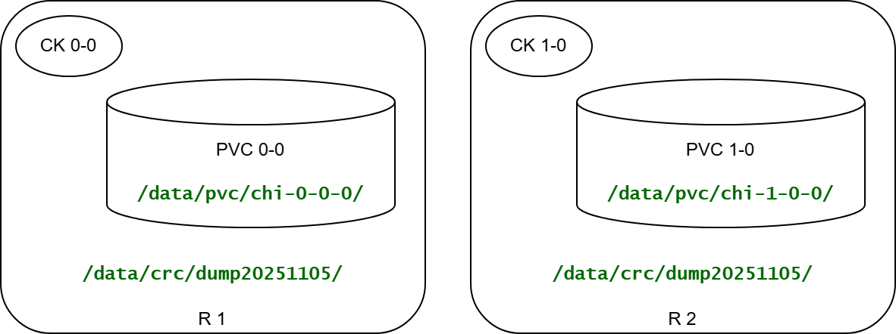
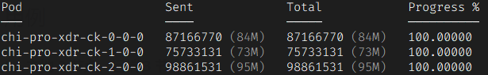

ClickHouse 集群拷贝迁移工具

________________________________________

# 简介

ClickHouse 拷贝迁移工具，命名为 ch-raw-copier，缩写简称 crc。

Crc 工具用于实现任意规模源 ClickHouse 集群到任意规模目的集群的整体数据搬迁，及账号授权信息、行策略、建表语句、SQL UDF 函数等信息的一次性同步能力。

Crc 工具有 send、restore、report 等3个子命令。send 命令用于把本地 ClickHouse 集群的选定表的选定分区的所有节点上的数据发送到远端主机；restore 命令用于把 send 命令拷贝的数据恢复到 ClickHouse 进程目录下并加载到库表中；report 命令用于监视 send 命令的数据传输进度。

Send 命令从源集群发送每个POD的数据到目的集群每个POD的 “脚下”，目的集群POD把数据捡起来。

## 前置要求

Crc 工具要求
1.	运行在 Kubernetes 集群的 Master 节点（或者配置好 kubeconfig 文件及 kubectl 工具的机器）上；
2.	Master 节点对集群内所有 Node 节点设置 SSH 公钥免密登录；
3.	源集群内所有 Node 节点对远端所有主机设置 SSH 公钥免密登录；
4.	本地和远端主机使用相同 SSH 账号名，比如 root 或 admin；
5.	本地和远端主机都安装了 rsync 命令。

## Send 命令

Send 命令用于将本地 ClickHouse 集群的数据发送到远端的多个主机。假设有5台本地机器 L1~L5，每台运行一个CK进程 CK N-0，2台远端机器 R1,R2。

Crc 首先将本地集群中 ClickHouse 的进程按 POD 名排序，得到列表 PODS=(CK-0-0, ...)；将远端机器按主机名排序，得到列表 REMOTE_HOSTS=(R1, R2)。

设 PODS 数组长度为 N、REMOTE_HOSTS 数组长度为 M，以 M 个远端主机为分组，从 PODS 数组中每次匹配 M 个 POD，最后余下 N % M 个 POD 未匹配。分组内的 POD 只需要将自己的数据发送给匹配的远端机器，余下未匹配的 N % M 个 POD 每个都需要将自己的数据均分发送到所有远端主机。如果 N > M，可以匹配到一个或多个分组，如果 N < M 则匹配不到分组。


 
脚本默认行为是将所有 POD 都与远端主机一对一匹配，要达到上述效果，需要给 send 子命令指定参数 --redistribute。

如果希望在源集群忽略某些 POD 的数据，但仍使这些 POD 参与匹配，可以结合使用 --keep-placeholder-pods 和 --shards 参数，比如当一个集群内有 Node 彻底宕机，send 命令可以先忽略该 Node 上运行的 POD，等待该 Node 恢复之后，再次执行 send 命令并忽略除此 Node 上之外的其它 POD，两次 send 命令中，本地 POD 与远端主机的匹配情况相同。


 
## Restore 命令

在数据恢复阶段，我们将视角切换到 2 台远端主机。假设 send 命令将源 ClickHouse 集群的数据发送到了此集群 R1,R2 主机的  /data/crc/dump20251105/ 目录。
 
Restore 命令首先将 /data/crc/dump20251105/ 目录中的数据移动到此主机运行的 ClickHouse 容器 PVC 目录 /data/pvc/chi-*-0-0/ 的各个表的子目录中，然后使用 ClickHouse SQL 命令 ALTER TABLE table ATTACH PARTITION 加载这些数据。



可以给 restore 命令指定 --map-database 和 --map-table 参数，以使数据加载到不同的库名或表名。例如，源集群发送了 business 库中的所有表数据，在目的集群恢复时可以指定 --map-database business=new_business 以使数据加载到 new_business 库中；--map-table 参数同理。

源集群的账号、授权、行策略、角色、SQL UDF 函数、建表语句、字典定义等信息可以分别指定 --access、--functions、–-ddl、--dictionaries 等参数进行恢复。

## Report 命令
用于汇总 Send 命令当前的数据传输进度


 
##  用例
1、本地 3 节点、远端 3 节点

在这种情况下，本地节点与远端节点是一对一完全匹配关系。

2、本地 1 节点、远端 3 节点

默认情况下，Crc 工具从远端 3 节点中选出第 1 个节点与本地节点匹配，余下 2 个远端节点空闲。指定 --redistribute 参数后，本地 1 个节点把数据均匀分发到远端 3 个节点。
  
## 命令行参数
```sh
ch-raw-copier --help 
Usage: ch-raw-copier <COMMAND> <MANDATORY_FLAG>... [FLAG]...

    1) ch-raw-copier send -H <REMOTE_HOSTS> -u <SSH_USER> -d <DIRECTORY> --db <DATABASE> [--tables <TABLES>]  [FLAG]...
    2) ch-raw-copier restore -u <SSH_USER> -d <DIRECTORY> --db <DATABASE> [--tables <TABLES>]  [FLAG]...
    3) ch-raw-copier report -u <SSH_USER> -d <DIRECTORY>  [FLAG]...
    4) ch-raw-copier relay -H <REMOTE_HOSTS> -u <SSH_USER> -d <DIRECTORY> [--remote-directory] --db <DATABASE> [--tables <TABLES>]  [FLAG]...
                        
Commands                
    send)                 Send data to the directory given as '--directory' on remote hosts.
    restore)              Restore data parts from the directory given as '--directory'.
    report)               Report progress of command 'send'.
    relay)                Re-send data from the directory given as '--directory' to remote hosts.
                          Unlike the others, this command runs for the directory only on local host.
Common flags            
    --kubeconfig):        Path of kubeconfig file.
    --ns|--namespace):    Kubernetes namespace where ClickHouse cluster lives. Auto detected by default.
    --k8s-label):         Kubernetes POD label of ClickHouse servers. Defaults to 'clickhouse.altinity.com/chi'.
    --internal-ip)        Use IP addresses of Kubernetes nodes as SSH hostnames. Otherwise DNS lookup entry should be
                          setup for each node (usually the /etc/hosts).
    --chc):               A single string containing flags to pass to clickhouse-client. Value of a flag should be
                          directly connected to the flag by equal sign '='. e.g. --chc "--echo -n --max_threads=4".
                          Can be specified multiple times.
    -j|--jobs):           How many concurrent jobs to run. Defaults to 1.
    -u|--user):           Mandatory. SSH user name for connecting with remote hosts. SSH public key authentication
                          should be setup for this user on all local and remote hosts.
    -p|--port):           SSH port to connect to on the remote hosts. Defaults to 22.
    -H|--hosts):          List of comma separated remote hosts. Mandatory for 'send' and 'relay', unless
                          auto-discovered via '--remote-bastion' or '--remote-namespace'.
    -d|--directory):      Mandatory. The remote target directory path when provided to 'send' command. Or the
                          source directory when provided to 'restore' command.
    -r|--replica):        Filter PODs belonging to replica N. Defaults to 0.
    -s|--shards):         Filter PODs belonging to these shards, specified as comma separated discrete ranges like
                          "1,3-8,10".
    -K|--keep-placeholder-pods)
                          Keep ClickHouse server PODs excluded by '--shards' as placeholders. That is, keep them in
                          place when peering local PODs with remote hosts, but does not actually copy data from them.
    --db|--database):     Mandatory. Filter data parts belonging to the database.
    --tables):            Filter data parts belonging to the tables. Specified as list of names separated by comma.
    --disk):              Select the disk to send data from or restore data into, if source/target ClickHouse
                          instance has multiple disks configured under <storage_configuration>. The storage layout
                          can be complex. For exmaple, the source ClickHouse may have 8 disks
                          ('default','disk1','disk2',...'disk7') grouped into two volumes, while the target
                          ClickHouse may have 4 disks ('default','extended1','extended2','extended3') grouped into a
                          single volume. There is no automatic or reliable way to determine how these disks should be
                          matched, user must explicitly specify a disk for each 'send'/'restore' command. Defaults to
                          'default'.
                          Note: Do not send data parts from multiple disks into the same '--directory'!
    --skip-checks)        Skip the DDL queue check, skip consistency check of objects, covering access entities,
                          functions, tables columns, table indexes, etc, before sending data to remote.
    --patch-rc)           Patch bashrc file for all local and remote hosts. To avoid executing any bash
                          initialization script for faster SSH connection.
    --dry)                Dry run. Not implemented.
    --no-cache)           No cache on Kubernetes API server responses.
    --cgroup):            Cgroup name to limit IO bandwidth. Defaults to 'crc-shared'. Creating cgroup requires root
                          privilege of the user given as '--user' on all local hosts.
    --io):                IO bandwidth in IEC format like '1G'. Defaults to unlimited.
    -v|--verbose)         Verbose output. This is equivalent to '--verbose' plus '--log-level debug'.
    -V|--very-verbose)    Very verbose output. This is equivalent to '--verbose' plus '--log-level trace'.
    --log-level):         Logging level.
    -h|--help)            This help text.
                        
Remote hosts auto-discovery (alternatives to '--hosts'; apply to 'send' and 'relay')
    -J|--remote-bastion):   [<USER>@]<ADDRESS>[:PORT]
                          SSH address of a bastion server with 'kubectl' access to the target Kubernetes cluster.
                          When set, the target's ClickHouse node IPs are auto-discovered by piping a shell snippet to
                          the bastion; '--hosts' is then populated implicitly and must NOT be given. Optional ':PORT'
                          suffix specifies the SSH port (e.g. 'user@host:2222'). The filters '--remote-k8s-label',
                          '--remote-shards' and '--remote-replica' refine what gets discovered.
    --remote-namespace|--ns2):  
                          Namespace where the target ClickHouse cluster lives.
                            * Without '--remote-bastion': discovery runs locally and assumes the target cluster is in
                                the same Kubernetes cluster as the source.
                            * With '--remote-bastion':    discovery runs on the bastion against the remote cluster;
                                if omitted, the bastion auto-detects the sole namespace that has matching PODs.
    --remote-k8s-label):   POD label selector used during remote-host discovery. Defaults to the value of
                          '--k8s-label'.
    --remote-replica):    Filter remote PODs by replica during discovery. Defaults to 0 (same as '--replica' for the
                          source side).
    --remote-shards):     Filter remote PODs by shard ranges during discovery; comma separated discrete ranges like
                          "1,3-8,10". Defaults to all shards.
                        
Flags for command 'send'
    --freeze):            Freeze the partitions with specified name before copying, and unfreeze it afterward.
    --no-unfreeze)        Do not unfreeze the partitions on finish.
    --partition_ids):     Filter data parts by partition IDs.
    --condition):         Condition on system.parts to filter for partition IDs. Prefered over `--partition_ids`.
    --redistribute)     
                          Each remote host is paired with a local ClickHouse server POD in sequential order. If there
                          are more local nodes than remote hosts, the extra local PODs redistribute their data across
                          all remote hosts based on the hash of the partition ID. This does not necessarily guarantee
                          a balanced distribution.
                          For example:
                          Case 1) 3 local nodes L1,L2,L3 and 2 remote hosts R1,R2
                              L1 -> R1
                              L2 -> R2
                              L3 -> R1,R2
                          Case 2) 5 local nodes L1-L5 and 2 remote hosts R1,R2
                              L1 -> R1
                              L2 -> R2
                              L3 -> R1
                              L4 -> R2
                              L5 -> R1,R2
                          Case 3) 2 local nodes L1,L2 and 3 remote hosts R1,R2,R3
                              L1 -> R1,R2,R3
                              L2 -> R1,R2,R3
                          If '--redistribute' is not requested, extra local nodes are paired with remote hosts in
                          sequential round-robin order.
    --rsync-strict)       Terminate the whole 'send' command on encountering any `rsync` error, except code 24 (partial
                          transfer due to vanished source files).
    --rsync-batch):       How many data parts to batch in a single 'rsync' command. Defaults to 500.
    --rsync-stats-batch-bytes):  
                          Update progress information in stats file each time the cumulative size of sent files
                          reaches the specified threshold (default: 100 MiB). For reference, recording progress
                          information introduces about 60 seconds of overhead when sending 1 TiB of data files with
                          the default threshold.
                        
Flags for command 'restore'
    -c|--command):        Command to use for restoring data parts. Possible alternatives are 'mv', 'rsync'. Defaults
                          to 'mv'.
    --map-db|--map-database):  
                          Given '--map-database old_name=new_name', restore data parts from database named 'old_name'
                          to database named 'new_name'. The option can be specified multiple times or as comma
                          separated pairs like 'old_name1=new_name1,old_name2=new_name2,...'.
    --map-table):         Given '--map-table old_name=new_name', restore data parts from table named 'old_name' to
                          table named 'new_name'. The option can be specified multiple times or as comma separated
                          pairs like 'old_name1=new_name1,old_name2=new_name2,...'.
    --ignore-detached)    Ignore exsiting detached parts. Not recommended because it's prone to part intersection
                          errors.
    --clear-detached)     Clear exsiting detached parts.
    --attach-detached)    Attach exsiting detached parts.
    --best-effort)        Restore data parts with best effort. When encountering:
                            1. parts intersection error, delete the part that has fewer rows;
                            2. missing files, checksum mismatches, or permission errors, delete the part;
                          then retry the operation. (Workers may still timeout during retries while the master
                          process performs rescue operations asynchronously.) Implies '--attach-detached'.
    --no-data)            Do not restore data parts.
    --chown):             Perform `chown -R <uid>:<gid>` before ATTACH PARTITION. For example '--chown 101:101'. By
                          default, it's auto decided by comparing permission bits of one random source data part with
                          those of the target directory.
    --truncate)           Truncate existing tables before restore.
    --drop)               Drop existing tables before restore. This implies '--ddl'.
    --replace)            Replace partitions from detached. This is done with a 'DROP PARTITION' before 'ATTACH
                          PARTITION'. Can not be used if there're more than one subdirectories in directory given by
                          '--directory', which is the case where multiple PODs had sent their data parts into the
                          directory. In other words, '--replace' conflicts with '--redistribute' in most cases.
                          Consider '--map-database', '--map-table' or '--drop' as alternatives.
    --ddl)                Restore database and table definitions.
    --access)             Restore access entities. This replaces the whole set of existing users, roles, profiles,
                          row policies, and grants.
    --functions)          Restore user defined SQL functions. This replaces existing functions with conflicting
                          names if any.
    --dictionaries)       Restore user defined SQL dictionaries. This replaces existing dictionaries with
                          conflicting names if any.
    --views)              Restore views and materialized views. This replaces existing views with conflicting names
                          if any.
    --zookeepers):        ZooKeeper cluster names provided in ClickHouse configuration files, to hold metadata of
                          Replicated MergeTree tables. Separate list of names with comma.
    --replica-id):        A unique identifier for replica path of Replicated MergeTree tables. Defaults to the table
                          UUID which is randomly generated. Used as zookeeper replica path of Replicated MergeTree
                          engine '/clickhouse/tables/{shard}/{database}/{table}/<replica-id>'.
    --restore-batch):     How many data parts to batch in a single 'mv' / 'rsync' command. Defaults to 50.
                        
Flags for command 'relay'
    --remote-directory):  
                          The remote target directory path. Should be specified after '--directory'. Defaults to
                          the same value as '--directory'.
                        
Note                    
  The flags '--map-database' and '--map-table' do not alter the meaning of '--database' and '--table'. The
  latter are used when enumerating data parts from the source database directory, while the former are applied
  when restoring data parts (enumerated from '--directory') into the target database directory. Therefore, a
  subsequent 'restore' command must use the same '--database' and '--table' values, if specified, as those used
  in the preceding 'send' command.
```
