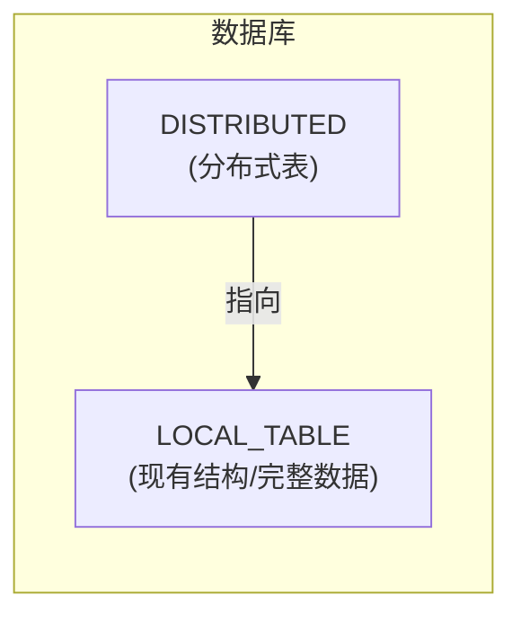
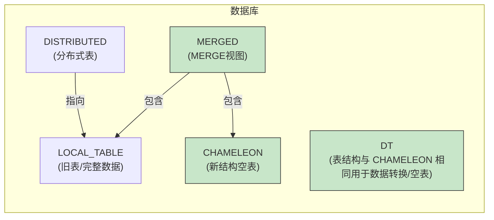
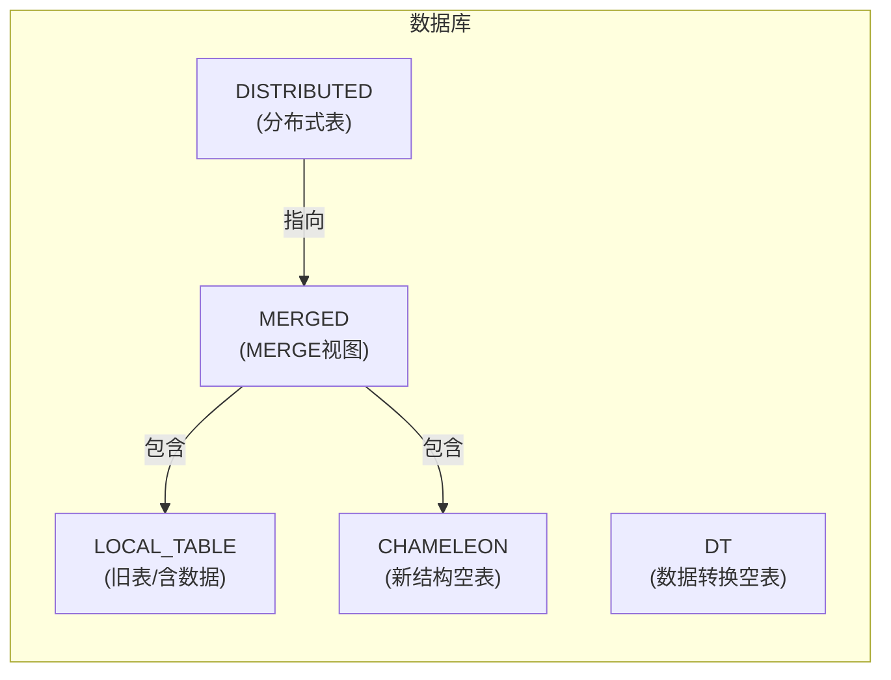
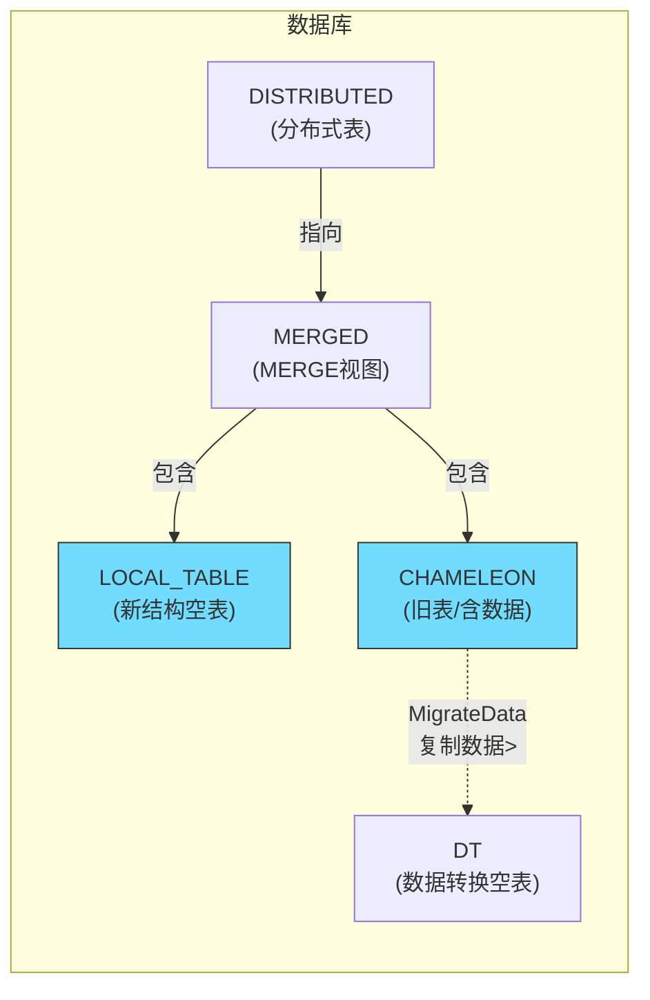
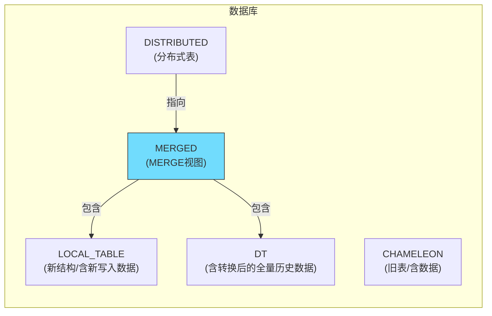
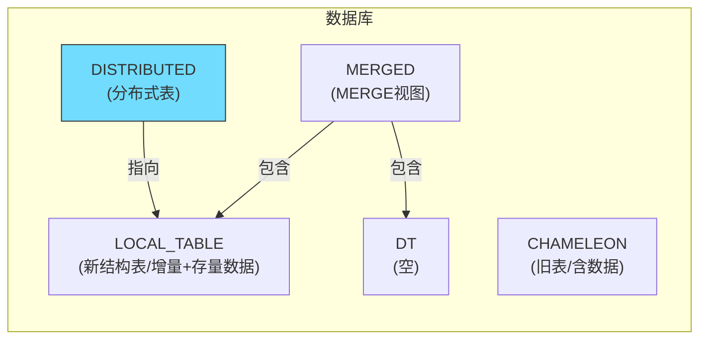
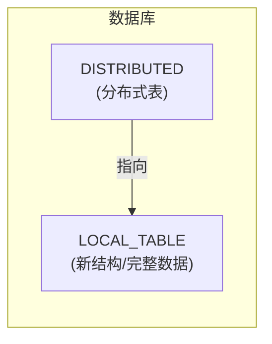

《ClickHouse 表结构迁移工具 - 上手指南》

# 工具简介

`ch-table-migration` 是一款 ClickHouse Merge 表引擎合表数据迁移工具，利用 Merge 表引擎实现表结构及数据的无感迁移，执行流程近乎完全自动化。

## 核心特性

- **断点继续能力**：脚本执行过程中会周期性地将内存状态持久化到状态目录，在关键代码区延迟系统信号处理
- **Systemd 集成**：初始化阶段向 Systemd 服务注册迁表任务，允许在任意点中断
- **高容错性**：容忍 ClickHouse 服务器宕机或运行脚本的主机本身宕机重启

## 前置条件

1. 使用 **Atomic 库引擎**，且被迁表的本地表与分布式表在同一个 Database 内
2. 迁移过程中，分布式表**无法写入**（这是 Merge 表引擎的缺陷），但可以正常查询
3. 确保 CK 集群内连接账号有足够的权限（查询系统表、查询被迁表）

---

# 概念解释

## 1. 关键表说明

| 表名 | 说明 |
|------|------|
| `LOCAL_TABLE`（原表） | 被迁移的旧表 |
| `CHAMELEON` 表 | 新结构的表，SwapTables 后指代原表 |
| `DT` 表 | 临时数据转换表，用于数据迁移 |
| `MERGE` 表 | 合并视图，指向多个表 |

## 2. 名词解释

- **Chameleon 表**：变色龙表，因交换表名后含义变化而得名
- **DT 表**：Data Transform 表，用于数据转换
- **Procedure**：流程，一系列状态的序列
- **State**：状态，包含一组可回滚的操作

## 3. 工作机制

本工具依赖两个 ClickHouse 特性：

1. **Merge 表引擎的联表查询能力**：Merge 表是一种特殊的表引擎，它可以指向多张表，并像查询一张表一样查询所有指向的表。这使得在迁移过程中，可以将新旧表都纳入查询范围，实现无缝切换。

2. **EXCHANGE TABLES 等 SQL 命令的原子性**：`EXCHANGE TABLES` 操作是原子性的，可以在集群范围内瞬间完成，不会出现中间状态导致的查询异常。

### 迁移过程图示


仅关注图中标彩的状态。

#### 0. CreateTables 之前



> 脚本对集群尚无任何变更

#### 1. CreateTables 之后



> DISTRIBUTED 仍指向 LOCAL_TABLE
> 新创建的表用淡绿色标识

#### 2. RedirectDistributedView 之后



> DISTRIBUTED 改为指向 MERGED，MERGED 包含 LOCAL_TABLE + CHAMELEON。
> 此时 CHAMELEON 为空，DISTRIBUTED 表写入会失败但查询正常。

#### 3. SwapTables 之后



> EXCHANGE TABLES 原子交换后：LOCAL_TABLE 变成新结构空表，CHAMELEON 变成旧表（含数据）。
> MigrateData 状态从 CHAMELEON 表 *复制* 数据到 DT 表。

#### 4. RedirectMergedView 之后



> MERGED 指向 LOCAL_TABLE + DT。
> MovePartitions 状态从 DT 表 *移动* 数据到 LOCAL_TABLE 表。

#### 5. RestoreDistributedView 之后



> DISTRIBUTED 重新指向 LOCAL_TABLE，DT 的分区已移动到 LOCAL_TABLE

#### 6. DropTables 之后（完成）



> 清理完成，只保留 DISTRIBUTED 和 LOCAL_TABLE

### 状态函数命名约定

源代码中的状态函数遵循以下命名约定：

| 前缀 | 含义 |
|------|------|
| `s_` | State 执行函数（do state） |
| `r_` | Revert 回滚函数（revert state） |
| `c_` | 清理函数（cleanup on error）|

例如：
- `s_PreMigrateData` - PreMigrateData 状态的执行逻辑
- `r_PreMigrateData` - PreMigrateData 状态的回滚逻辑
- `c_PreMigrateData` - PreMigrateData 出错时的清理逻辑

### 状态持久化机制

工具将状态信息保存在任务目录的文件中：

- `config` - 任务配置（必选）
- `state` - 当前状态变量
- `state.override` - 状态变量覆盖值。由 `set` 子命令生成
- `*.sql` - 各状态的 SQL 语句
- `*.sql.state` - SQL 执行进度

脚本会周期性地将内存状态持久化到磁盘，并在收到信号时延迟处理，以便在任意点中断后可以从断点继续。

### 流程自动选择逻辑

在 `s_Rearrange` 状态中，工具会根据数据量自动选择流程：

```bash
if (表为空)         -> simplest  # 最简流程
elif (数据量 <= 100万) -> simple   # 简化流程
else                 -> full      # 完整流程
```

可通过 `STATE_Rearrange_THRESHOLD` 变量调整阈值。

### 数据迁移策略

数据迁移按时间列分批进行：

1. 按 `STATE_MigrateData_DATETIME_COLUMN` 将数据分成若干时间槽
2. 每个时间槽的数据通过 `INSERT ... SELECT` + `DELETE WHERE` 方式迁移
3. 并发控制：通过 `STATE_MigrateData_CONCURRENCY` 调整并发数
4. 回滚时，如果目标表有新数据，会将数据迁移回源表后再重置

## 命令用法总览

```
ch-table-migration <COMMAND> [TASK_DIR] <[FLAG] | SET_VARS | PROCEDURE>...
```

### 命令分类

| 命令 | 功能描述 |
|------|----------|
| `list` | 列出所有迁表任务 |
| `init` | 初始化迁表任务目录 |
| `create` | 将迁表任务目录注册为 Systemd 服务 |
| `delete` | 删除已完成的 Systemd 任务 |
| `revert` | 回退当前或所有操作 |
| `pause` | 暂停任务执行 |
| `resume` | 继续执行暂停的任务 |
| `restart` | 重启任务 |
| `report` | 报告任务状态和进度 |
| `vars` | 打印所有可配置的状态变量 |
| `set` | 修改配置变量 |
| `rearrange` | 重新编排流程 |
| `walk` | 执行整个任务 |
| `walk_state` | 执行当前状态 |

## 常用命令帮助说明

### init 命令

```bash
ch-table-migration init <TASK_DIR> [FLAG]... [-v VAR_NAME=value]...
```

| 参数 | 说明 |
|------|------|
| `<TASK_DIR>` | **必须指定**：`<TASK_DIR>` 是 init 命令的第一个位置参数，用于指定任务目录，该目录会保存 config、state、state.override 等状态文件。 |
| `--create` | 同时执行 init 和 create（推荐使用） |
| `--cluster` | 集群名称 |
| `--db,--database` | 数据库名称 |
| `--distributed` | 分布式表名称 |
| `--shardingkey` | 分布式表分片键 |
| `--local` | **必须指定**：本地表名称 |
| `--reference-file` | DDL 参考文件（用于新表结构） |
| `--partitionby` | 修改 PARTITION BY 子句 |
| `--primarykey` | 修改 PRIMARY KEY 子句 |
| `--orderby` | 修改 ORDER BY 子句 |
| `--ttl` | 修改 TTL 子句 |
| `--procedure` | 指定迁移流程 |
| `--states` | 指定状态序列 |

### create 命令

```bash
ch-table-migration create <TASK_DIR> [FLAG]...
```

| 参数 | 说明 |
|------|------|
| `--start` | 立即启动新创建的任务 |

### delete 命令

```bash
ch-table-migration delete <TASK_DIR> [FLAG]...
```

| 参数 | 说明 |
|------|------|
| `--force` | 强制删除暂停中的任务 |
| `--pause` | 先暂停任务再删除 |
| `--directory` | 同时删除任务目录 |

### revert 命令

```bash
ch-table-migration revert <TASK_DIR> [FLAG]...
```

| 参数 | 说明 |
|------|------|
| `--all` | 回退所有操作 |
| `--to STATE_NAME` | 回退到指定状态之前 |

> **注意**：`MovePartitions` 状态之后不可回退。

### pause/resume 命令

```bash
ch-table-migration pause <TASK_DIR> [FLAG]...
ch-table-migration resume <TASK_DIR> [FLAG]...
```

| 参数 | 说明 |
|------|------|
| `-d\|--daemon` | 激活/停用 systemd 服务 |

> **注意**：不加 `--daemon` 仅修改 TASK_DIR 内的状态变量，不会立即改变脚本行为，脚本下次加载任务状态时才会生效。加 `--daemon` 参数会重启 systemd 服务，强制重新加载任务状态。

### report 命令

```bash
ch-table-migration report <TASK_DIR> [FLAG]...
```

| 参数 | 说明 |
|------|------|
| `-2\|--two-column` | 两列显示任务详情 |
| `--var` | 显示当前状态的变量 |

### 公共 Flags

| 参数 | 说明 |
|------|------|
| `--ns\|--namespace` | K8s 命名空间 |
| `--k8s-label` | K8s POD 标签 |
| `--chc` | 传递给 clickhouse-client 的参数 |
| `--force` | 强制执行 |
| `--log-level` | 日志级别 (debug/info/warn/error) |
| `--dry` | 试运行（仅调试） |
| `-h\|--help` | 显示帮助 |

---

# init 命令详解（核心）

`init` 命令用于初始化一个迁表任务，是使用该工具的第一步。

## 基本语法

```bash
./ch-table-migration init <TASK_DIR> [FLAGS...] [-v 'VAR_NAME=value' ...]
```

## 参数分类说明

### 1. 必选参数

| 参数 | 说明 | 示例 |
|------|------|------|
| `<TASK_DIR>` | 任务目录路径。用于保存迁表过程中的大量中间状态 | `tasks/http_log_local` |

### 2. 表标识参数

| 参数 | 说明 |
|------|------|
| `--local` | **必须指定**：被迁移的本地表名称 |
| `--db\|--database` | 所在数据库名称 |
| `--distributed` | 分布式表名称 |
| `--cluster` | 集群名称，默认为 '{cluster}' |

### 3. DDL 修改参数（用于生成新表结构）

| 参数 | 说明 | 示例 |
|------|------|------|
| `--partitionby` | 修改 PARTITION BY 子句 | `'toDate(recordTimestamp)'` |
| `--primarykey` | 修改 PRIMARY KEY 子句（留空使用空格 `' '`） | `' '` 或 `'(id,name)'` |
| `--orderby` | 修改 ORDER BY 子句 | `'(tenant,recordTimestamp,uuId)'` |
| `--ttl` | 修改 TTL 子句 | `'recordTimestamp + INTERVAL 30 DAY'` |
| `--reference-file` | 指定 DDL 参考文件路径。如果--partitionby/--orderby/--ttl 等参数无法满足改表需求，比如需要增加一些索引，可以把新表结构放到这个文件里 | `/path/to/ddl.sql` |

### 4. 流程与状态参数

| 参数 | 说明 |
|------|------|
| `--procedure` | 指定迁移流程（full/simple/simplest/lazy/full_no_stop_ttl） |
| `--states` | 指定状态序列（实验特性） |

### 5. 功能开关参数

| 参数 | 说明 |
|------|------|
| `--create` | 同时执行 init 和 create（推荐使用） |
| `--force` | 强制执行（覆盖已存在的任务） |
| `--start` | 创建后立即启动任务 |

### 6. ClickHouse 连接参数

| 参数 | 说明 |
|------|------|
| `--chc` | 传递给 clickhouse-client 的参数 |

示例：`--chc "--user=operator --password=default"`

### 7. 日志参数

| 参数 | 说明 | 可选值 |
|------|------|--------|
| `--log-level` | 日志级别 | `debug`/`info`/`warn`/`error` |

### 8. Kubernetes 参数（k8s 环境）

| 参数 | 说明 |
|------|------|
| `--ns\|--namespace` | ClickHouse 集群所在的 K8s 命名空间 |
| `--k8s-label` | ClickHouse 服务器的 K8s POD 标签（默认 `clickhouse.altinity.com/chi`） |

### 9. 变量赋值 `-v`

使用 `-v` 参数可以指定任意状态变量，支持多次指定：

```bash
-v 'VAR_NAME=value'
-v 'VAR_NAME="value with spaces"' # 含特殊字符时用单引号包裹
```

### 10. TASK_DIR 文件树结构

`TASK_DIR` 是保存任务状态的目录，结构如下：

```
<TASK_DIR>/
├── config                   # 任务配置文件，包含 CLUSTER、DATABASE、LOCAL_TABLE 等必选变量
├── state                    # 状态文件，记录当前 STATE、DIRTY、PAUSED 等状态变量
├── state.override           # 状态覆盖文件，由 pause、resume、set 等命令生成
├── last_error               # 最近错误信息，report 命令会显示其内容
├── consistency_report       # 一致性报告，由 ConsistencyReport 状态生成
├── dt.<POD>.sql             # MigrateData 状态的状态文件（每个 Pod 一个）
├── dt.<POD>.sql.state        # MigrateData 状态的 SQL 执行进度
├── move.<POD>.sql            # MovePartitions 状态的状态文件
├── move.<POD>.sql.state      # MovePartitions 状态的 SQL 执行进度
└── <NEW_DDL_REFERENCE>.sql   # 新表的 CREATE TABLE 查询语句
```

**说明**：
- `config`：由 `init` 命令生成，用户可编辑。config 文件用于给 create 命令提供创建任务的必要配置。
- `state`：由脚本自动维护，记录完整状态，**请勿手动修改**
- `state.override`：由 pause/resume/set 等用户命令生成，会覆盖 `state` 中的值
- `last_error`：记录最近的错误信息，便于排查问题
- `consistency_report`：MigrateData 迁移完成后的源、目的表数据一致性检查报告
- `dt.*.sql`、`move.*.sql`：各状态的 SQL 语句文件
- `*.sql.state`：对应 SQL 的执行进度状态

---

# init 命令参数速查表

| 参数 | 是否必须 | 说明 |
|------|----------|------|
| `<TASK_DIR>` | ✅ | 任务目录路径 |
| `--local` | ✅ | 被迁移的本地表名称 |
| `--db` | ❌ | 数据库名称（可自动发现） |
| `--database` | ❌ | 同上 |
| `--distributed` | ❌ | 分布式表名称（可自动发现） |
| `--cluster` | ❌ | 集群名称 |
| `--partitionby` | ❌ | 分区键表达式 |
| `--primarykey` | ❌ | 主键表达式（留空用空格） |
| `--orderby` | ❌ | 排序键表达式 |
| `--ttl` | ❌ | TTL 表达式 |
| `--procedure` | ❌ | 迁移流程类型 |
| `--states` | ❌ | 自定义状态序列 |
| `--create` | ❌ | 同时创建 systemd 服务 |
| `--force` | ❌ | 强制覆盖 |
| `--start` | ❌ | 创建后立即启动 |
| `--chc` | ❌ | clickhouse-client 参数 |
| `--log-level` | ❌ | 日志级别 |
| `--ns` | ❌ | K8s 命名空间 |
| `--k8s-label` | ❌ | K8s POD 标签 |
| `-v` | ❌ | 变量赋值（可多次使用） |

---

# 命令示例

```bash
./ch-table-migration init tasks/http_log_local \
    --log-level debug \
    --force \
    --create \
    --start \
    --chc "--user=default --password=default" \
    --db business \
    --local http_log_local \
    --partitionby 'toDate(recordTimestamp)' \
    --primarykey ' ' \
    --orderby '(tenant,recordTimestamp)' \
    -v STATE_MigrateData_DATETIME_COLUMN=recordTimestamp \
    -v STATE_DropTables_DROP_OLD_TABLE_IF_CONSISTENT=true;
```

## 各参数作用

| 参数 | 值 | 说明 |
|------|-----|------|
| `tasks/http_log_local` | 目录路径 | 任务目录（建议与表名对应） |
| `--log-level` | `debug` | 输出详细调试信息 |
| `--force` | 标志位 | 强制执行，覆盖已存在任务 |
| `--create` | 标志位 | 初始化后立即创建 systemd 服务 |
| `--start` | 标志位 | 创建后立即启动任务 |
| `--chc` | `"--user=default --password=default"` | ClickHouse 客户端连接参数 |
| `--db` | `business` | 数据库名称 |
| `--local` | `http_log_local` | 被迁移的本地表名称 |
| `--partitionby` | `'toDate(recordTimestamp)'` | 新表分区表达式（按日期分区） |
| `--primarykey` | `' '` | 留空，沿用原表设置 |
| `--orderby` | `'(tenant,recordTimestamp)'` | 新表排序键 |
| `-v STATE_MigrateData_DATETIME_COLUMN` | `recordTimestamp` | 数据迁移按该时间字段分批 |
| `-v STATE_DropTables_DROP_OLD_TABLE_IF_CONSISTENT` | `true` | 数据一致时删除旧表 |

## 不同表的 time column 差异示例

| 表名 | DATETIME_COLUMN |
|------|------------------|
| 大部分表 | `recordTimestamp` |
| `asset_log_local` | `insertTime` |
| `datalake_platform_log_local` | `insertTime` |
| `ioa_log_local` | `collect_api_receive_time` |
| `report_audit_log_local` | `cloudRecieveTimestamp` |
| `xdr_net_ops_local` | `uploadTimestamp` |

## orderby 差异示例

| 表名 | ORDER BY 表达式 |
|------|-----------------|
| 大部分表 | `'(tenant,recordTimestamp,uuId)'` |
| `dynamic_graph_log_local` | `'(tenant,recordTimestamp,srcVertexId)'` |
| `alert_relation_log_local` | `'(tenant,alertUuId,uuId)'` |
| `datalake_platform_log_local` | `'(tenant,uuId,insertTime)'` |
| `datalake_report_log_local` | `'(tenant,uuId,insertTime)'` |
| `report_audit_log_local` | `'(tenant,cloudRecieveTimestamp)'` |
| `weak_log_local` | `'(tenant,insertTime)'` |
| `xdr_net_ops_local` | `'(tenant,insertTime,uuId)'` |

---

# 状态变量详解

## 常用状态变量

| 变量名 | 默认值 | 说明 |
|--------|--------|------|
| `STATE_MigrateData_DATETIME_COLUMN` | - | **必须设置**：数据迁移的时间列名 |
| `STATE_MigrateData_DIRECTION` | `DESC` | 数据迁移方向（ASC/DESC） |
| `STATE_MigrateData_TIMESLOT_INTERVAL` | `4 HOUR` | 数据迁移批次间隔 |
| `STATE_MigrateData_CONCURRENCY` | `1` | 数据迁移并发数 |
| `STATE_MigrateData_CONCURRENCY_MODE` | `process` | 并发模式（thread/process） |
| `STATE_DropTables_DROP_OLD_TABLE` | `false` | 任务完成时删除旧表 |
| `STATE_DropTables_DROP_OLD_TABLE_IF_CONSISTENT` | `false` | 数据一致时删除旧表 |

## 修改状态变量的方式

```bash
# 方式一：使用 set 命令
./ch-table-migration set <TASK_DIR> 'STATE_MigrateData_DATETIME_COLUMN=recordTimestamp'

# 方式二：init 时通过 -v 指定
./ch-table-migration init tasks/xxx -v 'STATE_MigrateData_DATETIME_COLUMN=recordTimestamp'
```

## 状态变量使用示例

```bash
# 设置迁移时间列为 recordTimestamp
./ch-table-migration set tasks/http_log_local 'STATE_MigrateData_DATETIME_COLUMN=recordTimestamp'

# 设置数据一致时自动删除旧表
./ch-table-migration set tasks/http_log_local 'STATE_DropTables_DROP_OLD_TABLE_IF_CONSISTENT=true'

# 设置批次间隔为 1 小时
./ch-table-migration set tasks/http_log_local 'STATE_MigrateData_TIMESLOT_INTERVAL="1 HOUR"'

# 设置并发数为 4
./ch-table-migration set tasks/http_log_local 'STATE_MigrateData_CONCURRENCY=4'
```

---

# 迁移流程（Procedure）

## 流程类型

| 流程名称 | 适用场景 | 说明 |
|----------|----------|------|
| `full` | 大数据量表 | 完整流程，包含 TTL 操作 |
| `full_no_stop_ttl` | 大数据量表 | 完整流程，不执行 TTL 停止/恢复 动作 |
| `simple` | 小数据量表 | 简化流程，跳过索引/投影操作 |
| `simplest` | 空表 | 最简流程 |
| `lazy` | 延迟迁移 | 等待旧表数据淘汰后再继续收尾动作 |

## 指定流程的方式

```bash
# 方式一：init 时指定
./ch-table-migration init tasks/xxx --local xxx --procedure simple

# 方式二：Initialize 状态后重新编排
./ch-table-migration rearrange tasks/xxx full
```

---

# 各种状态的作用

以下为完整流程（`full`）中各状态的作用说明：

| 状态 | 作用 |
|------|------|
| `Initialize` | 初始化状态变量、依据表中数据量确定流程、检查库引擎类型、检查表存在性等依赖条件 |
| `CreateTables` | 创建3张辅助表 CHAMELEON、MERGE、DT。表结构与 LOCAL 表（被迁移的旧表）大致相同，表结构变更由 REFERENCE 文件或命令行参数指定 |
| `DropProjectionsAndIndexes` | 删除 DT 表的索引和投影 |
| `RedirectDistributedView` | 将分布式表指向 MERGE 表 |
| `SwapTables` | 互换 CHAMELEON 和 LOCAL 表（被迁移的旧表）的表名。交换表名之后 LOCAL 指代的是新创建的空表，CHAMELEON 指代的是含所有存量数据的旧表。由于 CHAMELEON 前后指代不同的表，容易造成混淆，所以使用 Chameleon 变色龙这个词做强调 |
| `StopTTLMerges` | 停止 CHAMELEON 表的 TTL 活动 |
| `WaitPartsStableChameleon` | 等待 CHAMELEON 表合并活动息止 |
| `PreMigrateData` | 预备迁移数据 |
| `MigrateData` | 从 CHAMELEON 表复制数据到 DT 表 |
| `WaitPartsStableDT` | 等待 DT 表合并息止 |
| `ConsistencyReport` | 生成一致性报告，比对 DT 表与 CHAMELEON 表的数据一致性 |
| `Pause_1` | 暂停等待人工介入确认 |
| `CopyDDLProjectionsAndIndexes` | 从 LOCAL 表复制索引和投影定义到 DT 表 |
| `MaterializeProjectionsAndIndexes` | 将 DT 表的索引和投影进行物化 |
| `WaitMaterializationDone` | 等待 DT 表的物化活动完成 |
| `RedirectMergedView` | 将 MERGE 表指向 LOCAL 和 DT 两张表 |
| `PreMovePartitions` | 预备移动分区 |
| `MovePartitions` | 将 DT 表中的所有分区移动到 LOCAL 表中 |
| `RestoreDistributedView` | 将分布式表指向 LOCAL 表 |
| `StartTTLMerges` | 恢复 CHAMELEON 表的 TTL 活动 |
| `DropTables` | 删除 DT 表、MERGE 表，如果用户参数允许并且 ConsistencyReport 生成的报告显示新旧表数据一致，删除 CHAMELEON 表 |
| `Complete` | 结束状态。无动作 |

---

# 常用操作示例

## 1. 创建并启动迁移任务

```bash
# 最简方式（自动发现 db 和 distributed）
./ch-table-migration init tasks/http_log_local \
    --create --start \
    --chc "--user=operator --password=default" \
    --db business \
    --local http_log_local \
    --partitionby 'toDate(recordTimestamp)' \
    --orderby '(tenant,recordTimestamp,uuId)' \
    -v STATE_MigrateData_DATETIME_COLUMN=recordTimestamp
```

## 2. 查看任务列表

```bash
./ch-table-migration list
# 或显示相对路径
./ch-table-migration list --relative
```

### 输出解读

```
Name        State                Dirty   Paused  Revert To    Task Directory         Locked*  Systemd Unit
────        ─────                ─────   ──────  ─────────    ──────────────         ───────  ────────────
acl_log     CreateTables         false   false   N/A          /path/to/tasks/acl     *        chtm_acl_log.service
tcp_log     Complete             false   false   N/A          /path/to/tasks/tcp               chtm_tcp_log.service
dns_log     MigrateData          true    false   N/A          /path/to/tasks/dns               chtm_dns_log.service
http_log    MigrateData          false   false   SwapTables   /path/to/tasks/http              chtm_http_log.service
```

| 列名 | 说明 |
|------|------|
| `Name` | 任务名称（来自 systemd 服务名 `chtm_<name>.service`） |
| `State` | 当前所处状态（如 `Initialize`、`CreateTables`、`MigrateData` 等） |
| `Dirty` | 状态是否"脏"（有未完成的修改，中断后继续执行会先清理或回退当前状态的所有修改，然后重新执行当前状态应做的动作） |
| `Paused` | 任务是否被暂停 |
| `Revert To` | 回退目标状态（`N/A` 表示未在回退中） |
| `Task Directory` | 任务状态文件保存目录 |
| `Locked*` | 任务目录是否被锁定，带 `*` 表示锁定中。这表示有进程正在这个目录上执行（锁定 + Paused 表示进程暂停执行，但是仍然在轮询等待 Paused=false，即 `resume` 命令） |
| `Systemd Unit` | 对应的 systemd 服务名 |


### list 命令输出示例


## 3. 查看任务状态

```bash
./ch-table-migration report tasks/http_log_local
# 两列显示
./ch-table-migration report tasks/http_log_local --two-column
```

### report 输出解读

`report` 命令用于查看单个任务的详细状态和进度，输出包含以下几个部分：

**1. Overview（概览）**

```
Overview
    STATE=CreateTables  DIRTY=false  PAUSED=false  REVERT=N/A
```

显示当前任务的基本状态信息：
- `STATE`：当前所处状态
- `DIRTY`：是否有未持久化的修改（中断后继续会重新执行当前状态）
- `PAUSED`：任务是否被暂停
- `REVERT`：回退目标状态（N/A 表示未在回退中）

**2. States Flow（状态流程）**

```
States Flow (full)*
Initialize(3s) → CreateTables(5m) → DropProjectionsAndIndexes → ...
                   ↑ 当前状态（带下划线）
```

显示当前流程的所有状态序列，括号内为该状态的执行耗时，当前状态以**蓝色下划线**高亮，`*` 表示任务目录被锁定。

**3. Detail（详情，根据当前状态显示不同内容）**

| 当前状态 | 显示内容 |
|----------|----------|
| `MigrateData` | 各 Pod 的数据迁移进度：DT Table 行数、Chameleon Table 行数、进度百分比、预计完成时间 (ETA) |
| `WaitMaterializationDone` | 索引/投影物化进度：执行中的 Mutations、待处理的 Parts、是否完成、失败原因 |
| `MovePartitions` | 各 Pod 待移动的分区数量 |
| `ConsistencyReport` 及之后 | 数据一致性报告 |
| `Complete` | "Task Completed" |

**4. Most Recent Error Messages（最近的错误）**

显示最近 20 条错误信息，便于排查问题。


## 4. 暂停/恢复任务

> **注意**：不加 `--daemon` 参数仅修改 TASK_DIR 内的状态变量，不会立即改变脚本进程的行为，脚本下次加载任务状态时才会生效。加 `--daemon` 参数会重启 systemd 服务，强制重新加载任务状态。

```bash
# 暂停任务（仅修改状态变量，下次加载生效）
./ch-table-migration pause tasks/http_log_local

# 暂停并停止 systemd 服务（立即生效）
./ch-table-migration pause tasks/http_log_local --daemon

# 恢复任务（仅修改状态变量，下次加载生效）
./ch-table-migration resume tasks/http_log_local

# 恢复并启动 systemd 服务（立即生效）
./ch-table-migration resume tasks/http_log_local --daemon
```

## 5. 回退任务

> **注意**：`MovePartitions` 状态之后不可回退。

```bash
# 回退到上一个状态
./ch-table-migration revert tasks/http_log_local

# 回退所有操作
./ch-table-migration revert tasks/http_log_local --all

# 回退到指定状态
./ch-table-migration revert tasks/http_log_local --to CreateTables

# 立即应用（终止当前进程后回退）
./ch-table-migration revert tasks/http_log_local --daemon
```

## 6. 删除任务

```bash
# 删除已完成的任务
./ch-table-migration delete tasks/http_log_local

# 强制删除暂停中的任务
./ch-table-migration delete tasks/http_log_local --force

# 暂停后删除
./ch-table-migration delete tasks/http_log_local --pause

# 同时删除 systemd 服务和任务目录
./ch-table-migration delete tasks/http_log_local --directory
```

## 7. 修改流程

```bash
# 将流程改为 full。只能紧跟在 Initialize 状态之后使用
./ch-table-migration rearrange tasks/http_log_local full
```

---

# 故障排查

## 查看日志

```bash
# 使用 debug 级别查看详细日志
./ch-table-migration init ... --log-level debug

# 查看 systemd 日志
journalctl -u chtm-xxx -f

# 查看任务目录内的状态文件
cat tasks/xxx/state
```

**journalctl 日志状态标记含义**

| 状态标记 | 含义 |
|----------|------|
| `CreateTables*` | 状态正在执行。`*` 表示 Dirty |
| `MigrateData(R)` | 正在回退该状态的所有变更。大写 R 表示完全回退直到 Initialize 状态 |
| `MigrateData(r)` | 正在回退该状态的所有变更。小写 r 表示回退到 `Revert To` 指定的状态 |

## 注意事项

1. **迁移过程中分布式表无法写入**，请提前通知业务方
2. 确保账号在集群内有足够的权限
3. 大数据量表建议使用 `full` 流程
4. 旧表删除后数据不可恢复，请谨慎操作
5. `MovePartitions` 状态之后不可回退

---

# 快速参考

## 创建任务模板

```bash
./ch-table-migration init tasks/<TABLE>_local \
    --log-level debug \
    --force \
    --create \
    --start \
    --chc "--user=<USER> --password=<PASSWORD>" \
    --db <DATABASE> \
    --local <TABLE>_local \
    --partitionby 'toDate(<TIMESTAMP_COLUMN>)' \
    --orderby '(<ORDER_KEYS>)' \
    -v STATE_MigrateData_DATETIME_COLUMN=<TIMESTAMP_COLUMN> \
    -v STATE_DropTables_DROP_OLD_TABLE_IF_CONSISTENT=true;
```

## 查看帮助

```bash
./ch-table-migration --help
./ch-table-migration vars
```
