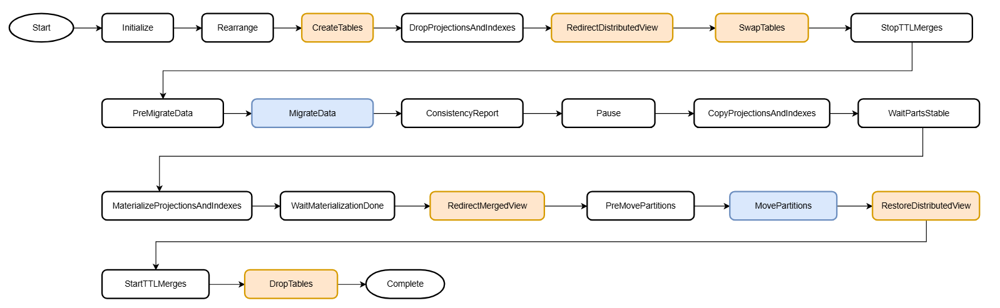
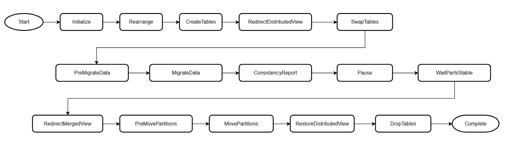
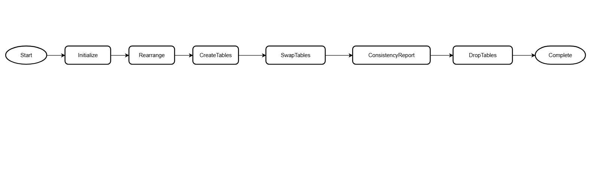
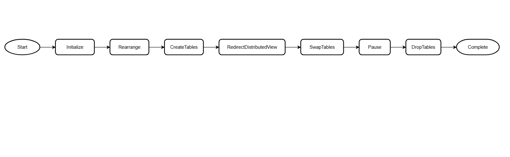
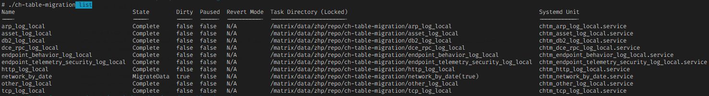
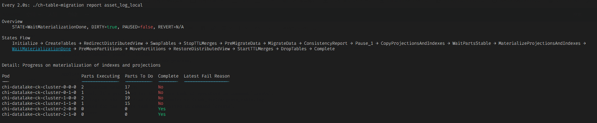

ClickHouse Merge 表引擎合表数据迁移工具  

# 工具简介  

该工具利用 Merge 表引擎实现了表结构及数据的无感迁移，且执行流程近乎完全自动化。  
脚本在执行过程中会周期性地将内存状态持久化到状态目录，并且在关键代码区延迟系统信号处理，因此具有断点继续能力；另外脚本在初始化阶段向 Systemd 服务注册迁表任务，因此在迁表过程中允许在任意点中断，容忍任意ClickHouse服务器宕机或者运行脚本的主机本身宕机重启。  

# 前置条件  

使用限制条件：  
1.	使用 Atomic 库引擎，且被迁表的本地表与分布式表在同一个 Database 内。  
2.	迁移过程中，分布式表无法写入（这是 Merge 表引擎的缺陷），但可以正常查询。  
3.	由于迁表过程中会频繁使用 clusterAllReplicas 函数判断当前状态，所以请确保 CK 集群内连接账号有足够的权限（查询系统表、查询被迁表）；参见 社区文档关于 remote_servers 的配置。  

# 迁表流程  
迁表流程分为5种，完整流程、简化流程、最简流程。每种流程适用场景不同，在 Rearrange 状态根据表中数据量大小进行适配。  

## 1、完整流程  

  

适用于存储大量数据的表。  

各种状态的动作：
| 状态名 | 动作 |
| :-- | :-- |
| Initialize | 初始化状态变量、依据表中数据量确定流程、检查库引擎类型、检查表存在性等依赖条件 |
| CreateTables | 创建3张辅助表 CHAMELEON、MERGE、DT。表结构与 LOCAL 表（被迁移的旧表）大致相同，表结构变更由 REFERENCE 文件或命令行参数指定，参见下方命令行帮助。 |
| DropProjectionsAndIndexes | 删除 DT 表的索引和投影 |
| RedirectDistributedView | 将分布式表指向 MERGE 表 |
| SwapTables | 互换 CHAMELEON 和 LOCAL 表（被迁移的旧表）的表名。交换表名之后 LOCAL 指代的是新创建的空表，CHAMELEON 指代的是含所有存量数据的旧表。由于 CHAMELEON 前后指代不同的表，容易造成混淆，所以使用 Chameleon 变色龙这个词做强调。 |
| StopTTLMerges | 停止 CHAMELEON 表的 TTL 活动 |
| WaitPartsStableChameleon | 等待 CHAMELEON 表合并活动息止 |
| PreMigrateData | 预备迁移数据 |
| MigrateData | 从 CHAMELEON 表复制数据到 DT 表 |
| WaitPartsStableDT | 等待 DT 表合并息止 |
| ConsistencyReport | 生成一致性报告，比对 DT 表与 CHAMELEON 表的数据一致性 |
| Pause | 暂停等待人工介入确认 |
| CopyDDLProjectionsAndIndexes | 从 LOCAL 表复制索引和投影定义到 DT 表 |
| MaterializeProjectionsAndIndexes | 将 DT 表的索引和投影进行物化 |
| WaitMaterializationDone | 等待 DT 表的物化活动完成 |
| RedirectMergedView | 将 MERGE 表指向 LOCAL 和 DT 两张表 |
| PreMovePartitions | 预备移动分区 |
| MovePartitions | 将 DT 表中的所有分区移动到 LOCAL 表中 |
| RestoreDistributedView | 将分布式表指向 LOCAL 表 |
| StartTTLMerges | 恢复 CHAMELEON 表的 TTL 活动 |
| DropTables | 删除 DT 表、MERGE 表，如果用户参数允许并且 ConsistencyReport 生成的报告显示新旧表数据一致，删除 CHAMELEON 表 |
| Complete | 结束状态。无动作。 |

## 2、简化流程  
  
适用于存储少量数据的表  
   
## 3、最简流程  
  
适用于空表  
   
## 其他流程  
4、完整流程不带TTL操作  
在完整流程的基础上去掉 StopTTLMerges 和 StartTTLMerges 操作  
5、Lazy 流程  
Lazy 流程与最简流程相似，没有迁数据的动作，区别在于 Lazy 流程中的 Pause 步骤会备份状态文件夹，并立即退出。等待旧表数据全部淘汰之后，由人工确认旧表状态，运行 resume 命令拉起脚本继续完成后续收尾流程。  
   
  

# 使用方式  
```sh
ch-table-migration --help   
Usage:  ch-table-migration  <COMMAND>  [TASK_DIR]  <[FLAG] | SET_VARS | PROCEDURE>...  

    1) ch-table-migration  list|prune|vars  [FLAG]...  
    2) ch-table-migration  init|create|delete|revert|pause|resume|restart|report|set|walk|walk_state  <TASK_DIR>  [FLAG]...  
    3) ch-table-migration  set  <TASK_DIR>  <SET_VARS>...  
    4) ch-table-migration  rearrange  <TASK_DIR>  PROCEDURE  
                          
Commands                  
    list)                 List all tasks.  
    init)                 Initialize a task directory.  
    create)               Create a new task from an existing task directory. A newly created task is put in paused state, with  
                          --start flag to run it immediately. With --force to overwrite an existing systemd service.  
    delete)               Delete systemd unit file of a task. The task should be in Complete state, or with --force flag to delete a  
                          paused task. With both flags --force and --pause to pause a running task and delete it (at your own risk).  
                          With flag --directory to remove the task directory.  
    prune)                Delete inactive systemd units of which the task directory does not exist.  
    revert)               Revert operations that current state of the task has done. With --all to revert all operations that a task  
                          has done. With --to STATE_NAME to revert all operations back until STATE_NAME. The running process will  
                          take the revert only after finishing current state. To apply it immediately, specify --daemon flag to  
                          restart the running daemon process. Or run 'restart' afterwards.  
                          Note: Tasks cannot be reverted in and after state MovePartitions.  
    pause)                Pause a task. By default this command only modifies states in task directory, with --deamon flag to  
                          actually deactivate the systemd service. With --grace to wait for some time (defaults to 0 seconds) before  
                          killing the process.  
    resume)               Resume a paused task. By default this command only modifies states in task directory, with --deamon flag  
                          to actually activate the systemd service.  
    restart)              Restart the task.  
    report)               Report task progress or result of some state.  
    vars)                 List all configurable state variables, also list the variables that are mandatory in 'config' file.  
    set)                  Set state variables for a task. For example: set <TASK_DIR> "STATE_ConsistencyReport_TIMESLOT_INTERVAL='1 HOUR'"  
                          Ensure to quote the assignment with extra quotation marks if value contains some spaces,  
                          like 'var="va lue"', "var='va lue'", or "var=\"va lue\"", instead of var="va lue"  
    rearrange)            Rearrange procedures. Run `vars` to check all predefined procedures.  
    walk)                 Execute the whole task.  
    walk_state)           Execute current state.  
                          
Flags for command init    
    --create)             Create the task as well. As if `init <TASK_DIR>` followed by `create <TASK_DIR>`  
    --cluster):           The CLUSTER variable.  
    --db|--database):     The DATABASE variable.  
    --distributed):       The DISTRIBUTED_TABLE variable.  
    --shardingkey):       The DISTRIBUTED_TABLE_SHARDING_KEY variable.  
    --local):             The LOCAL_TABLE variable. Mandatory.  
    --reference-file):    File that stores DDL query of the new table. The NEW_DDL_REFERENCE variable  
    --partitionby):       Creates a template DDL from existing $LOCAL_TABLE with different PARTITION BY clause.  
    --primarykey):        Creates a template DDL from existing $LOCAL_TABLE with different PRIMARY KEY clause.  
    --orderby):           Creates a template DDL from existing $LOCAL_TABLE with different ORDER BY clause.  
    --ttl):               Creates a template DDL from existing $LOCAL_TABLE with different TTL clause.  
    --procedure):         The PROCEDURE variable.  
    --states):            The `states' variable.  
    -v):                  Specify variable assignments. For exmaple the flag --shardingkey 'rand()' can also be  
                          given as -v 'DISTRIBUTED_TABLE_SHARDING_KEY="rand()"'. Can be specified multiple times.  
                          Note: Please note the extra quotes if there are spaces inside the value:  
                              -v "name='v a l u e'"  
                              -v 'name="v a l u e"'  
                              -v "name=\"v a l u e\""  
                          
Flags for command list    
    --relative)           Display task directory path as relative to current working directory.  
                          
Flags for command create  
    --start)              Start the newly created task immediately  
                          
Flags for command revert  
    --all)                Revert all operations that a task has done.  
    --to):                Revert all operations back until this state.  
                          
Flags for command delete  
    --pause)              Pause the task first.  
    --directory):         Delete task directory.  
                          
Flags for command report  
    -2|--two-column)      Display detail of task in 2 columns.  
    --var):               Display variables for current state.  
                          
Common flags              
    --ns|--namespace):    Kubernetes namespace where ClickHouse cluster lives. Applies to command 'init', 'create'.  
    --k8s-label):         Kubernetes POD label of ClickHouse servers. Defaults to 'clickhouse.altinity.com/chi' Applies  
                          to command 'init', 'create'.  
    --chc):               A single string containing flags to pass to clickhouse-client. Value of a flag should be directly  
                          connected to the flag by equal sign '='. e.g. --chc "--echo -n --max_threads=4". Can be specified multiple  
                          times.  
    --force)              Force action on command 'create', 'delete'  
    -d|--daemon)          Activate/deactivate systemd services. Without the flag, commands 'pause', 'resume', 'revert' only change  
                          state variables in task directory. Applies to command 'pause', 'resume', 'revert'  
    --grace):             Wait for some time before killing the task process. Defaults to 0 seconds. Applies to command 'pause',  
                          'delete'  
    --ech):               --ech flags to pass to for_each_line2.sh  
    --dry)                Dry run. Debugging usage only.  
    --log-level):         Logging level. It's persisted for the entire task if specified in command 'create'.  
    -h|--help)            This help text.  

Definitions  
  'procedure'  A sequence of states that are mostly revertable with best effort.  
  'state'      A defined set of actions to do, based on some prerequisites, to establish new prerequisites for the next state.  
               The actions are mostly revertable with best effort. A temporary 'try->fail->revert->retry' loop may occur.  
  'Chameleon table'   The table with new structure created in state CreateTables, exchanged with the original $LOCAL_TABLE  
                      table in state SwapTables. Therefore it refers to the new empty table before state SwapTables and to  
                      the original table after state SwapTables, thus the name 'chameleon'.  
  'DT table'    A table with new structure created in state CreateTables alongside the 'Chameleon table'. It is used to  
                transform data from the original $LOCAL_TABLE table, which is named <LOCAL_TABLE>__CHAMELEON after tables  
                swapped. On completing data transformation, all partitions will be moved from DT table to the new  
                $LOCAL_TABLE table during state MovePartitions.  

Examples  
    1. Initialize a task directory and register as systemd unit  
        ch-table-migration  init  tcp_log_local  --create --cluster '{cluster}' --db business --local tcp_log_local --procedure simple  

    2. Configure the task to drop chameleon table in DropTables state  
        ch-table-migration  set  tcp_log_local  STATE_DropTables_DROP_OLD_TABLE=true  

    3. Rearrange to 'full' procedure. This should be done right after state Initialize  
        ch-table-migration  rearrange  tcp_log_local  full  

Note  
    Please ensure the 'default' account (or the account specified via --chc "--user=<username>") is authorized throughout the  
    cluster to CREATE, DROP, INSERT INTO new tables, query on system tables and the target table. Otherwise the script is unable  
    to carry out the task correctly, for example, runs into a wrong procedure 'simplest' which presumes chameleon table to be empty.  
```

## list 列出所有迁表任务  
  
   
## init 创建迁表任务目录  
## create 将迁表任务目录注册为 Systemd 任务  
## delete 删除已完成的 Systemd 任务  
## revert 回退当前或所有操作  
## pause/resume 暂停、继续执行  
## report 报告任务状态和进度  
  
   
## vars 打印配置变量  
任务配置变量有些是通用的，有些是只用在某个状态的。任务配置变量需要用 set 命令（见下文）修改，请勿直接修改任务目录内的文件。  

```sh
# ./ch-table-migration vars  
All Available State Variables  
    declare -a state_variables=(  
        ## From 'config'  
        CLUSTER DATABASE  
        LOCAL_TABLE       # Name of the table to migrate  
        DISTRIBUTED_TABLE # Name of distributed table  
        DISTRIBUTED_TABLE_SHARDING_KEY # Defaults to 'rand()'  
        NEW_DDL_REFERENCE # Path to file that contains `CREATE TABLE` query of new table structure.  
                          # Table name and the zookeeper path of replicated engines will be substituted with some other values.  
        ## About command line  
        KUBECTL # Can be set to like 'KUBECTL="kubectl --kubeconfig=/path/to/alternative/kube.conf"'  
        ZOOKEEPER       # ZooKeeper cluster name  
        ## Configuration variables from 'config' or 'state.override'  
        REPLICATED_MUTATION_THREADS # Mutation threads for Replicated.*MergeTree. Defaults to 2.  
        REPLICATED_ALL_REPLICAS     # For replicated tables, should we do the data copying on all replicas ?  
                                    # Setting it to 'true' may result in 2-fold duplicated data. Defaults to 'false'.  
        ## State related  
        STATE_Rearrange_THRESHOLD    # Minimum rows to arrange the full procedure. Defaults to 1000000.  
        STATE_Pause_ForLazy_BACKUP_DIR  # Directory to backup the task directory. Defaults to parent directory of the task directory.  
        STATE_DropProjectionsAndIndexes_DISTRIBUTED_DDL_TASK_TIMEOUT  # Value of setting 'distributed_ddl_task_timeout' on `ALTER TABLE DROP INDEX/PROJECTION`  
        STATE_SwapTables_COMPARE_DDL_INCLUDING_SETTINGS  # Should we consider 'SETTINGS' section while comparing table structures ? Defaults to 'false'.  
        STATE_SwapTables_COMPARE_DDL_IGNORING_REGEX      # Regex to ignore when comparing DDL structure.  
        STATE_MigrateData_DATETIME_COLUMN   # Name of column of *Int* or DateTime type, according what, to migrate data sequentially.  
        STATE_MigrateData_DIRECTION         # 'ASC' or 'DESC' datetime direction of data migration. Defaults to 'DESC'  
        STATE_MigrateData_TIMESLOT_INTERVAL # Data migration batch interval. Defaults to '4 HOUR'  
        STATE_MigrateData_CONCURRENCY       # Data migration concurrency for each POD. Defaults to 1.  
        STATE_MigrateData_CONCURRENCY_MODE  # Data migration concurrency mode, 'thread' or 'process'. Defaults to 'process'.  
        STATE_ConsistencyReport_TIMESLOT_INTERVAL # Defaults to $STATE_MigrateData_TIMESLOT_INTERVAL  
        STATE_WaitPartsStable_STABLE_THRESHOLD      # Defaults to 1  
        STATE_WaitPartsStable_INTERVAL              # Interval to check number of parts to become stable. Defaults to 0 (seconds), which means it waits  
                                                    # only until no active merges in table.  
        STATE_WaitBusyReplicatedFetches_THRESHOLD   # Defaults to 0  
        STATE_WaitBusyReplicatedMerges_THRESHOLD    # Defaults to 0  
        STATE_WaitBusyMerges_THRESHOLD                      # Defaults to 0  
        STATE_WaitMaterializationDone_INTERVAL              # Defaults to 10 (seconds)  
        STATE_MovePartitions_CONCURRENCY        # Concurrently move partitions from table $LOCAL_TABLE_DT to $LOCAL_TABLE. High concurrency poses  
                                                # heavy load on ZooKeeper with replicated table engines. Defaults to 1  
        STATE_MovePartitions_DIRECTION          # Move partitions in 'ASC' or 'DESC' order. Defaults to 'ASC'.  
        STATE_DropTables_DROP_OLD_TABLE               # Drop the old table ? All data in old table has been migrated to the new table at this point.  
                                                      # Defaults to 'false'  
        STATE_DropTables_DROP_OLD_TABLE_IF_CONSISTENT # Drop the old table if data is consistent between tables $LOCAL_TABLE_DT and $LOCAL_TABLE_CHAMELEON  
                                                      # as reported by ConsistencyReport. All data in old table has been migrated to the new table at this  
                                                      # point. Defaults to 'false'  
    )  
State Variables Required in Configuration File  
    declare -a config_required_state_variables=(  
        # These state variables should be specified by user in '<TASK_DIR>/config'.  
        CLUSTER           # Defaults to '{cluster}'  
        DATABASE          # Can be auto discovered by 'init' command if there's only one database containing a table with name $LOCAL_TABLE  
        LOCAL_TABLE       # Name of the table to migrate  
        DISTRIBUTED_TABLE # Can be auto discovered by 'init' command if there's only one Distributed table referencing $LOCAL_TABLE  
        NEW_DDL_REFERENCE # In 'init' command, file '$NEW_DDL_REFERENCE' will be populated with CREATE TABLE query of the new table according to command  
                          # line flags like '--partitionby'/'--orderby'.  
        STATE_MigrateData_DATETIME_COLUMN  
        # STATE_MigrateData_AXIS_COLUMN # TODO refactor data migration script to use a generic axis column.  
    )  
Procedures  
    # Run `rearrange <TASK_DIR> <PROCEDURE>` to switch procedure right after state Initialize, or specify procedure in 'init' command with flag --procedure.  
    full  
        Initialize CreateTables DropProjectionsAndIndexes RedirectDistributedView SwapTables StopTTLMerges WaitPartsStableChameleon  
        PreMigrateData MigrateData WaitPartsStableDT ConsistencyReport Pause_1 CopyDDLProjectionsAndIndexes  
        MaterializeProjectionsAndIndexes WaitMaterializationDone RedirectMergedView PreMovePartitions MovePartitions  
        RestoreDistributedView StartTTLMerges DropTables Complete  
    full_no_stop_ttl  
        Initialize CreateTables DropProjectionsAndIndexes RedirectDistributedView SwapTables WaitPartsStableChameleon PreMigrateData  
        MigrateData WaitPartsStableDT ConsistencyReport Pause_1 CopyDDLProjectionsAndIndexes MaterializeProjectionsAndIndexes  
        WaitMaterializationDone RedirectMergedView PreMovePartitions MovePartitions RestoreDistributedView DropTables Complete  
    simple  
        Initialize CreateTables RedirectDistributedView SwapTables WaitPartsStableChameleon PreMigrateData MigrateData WaitPartsStableDT  
        ConsistencyReport Pause_IfNotConsistent RedirectMergedView PreMovePartitions MovePartitions RestoreDistributedView DropTables  
        Complete  
    simplest  
        Initialize CreateTables SwapTables ConsistencyReport DropTables Complete  
    lazy  
        Initialize CreateTables RedirectDistributedView SwapTables Pause_ForLazy DropTables Complete  
```

### set 修改配置变量  
注意在含空格、特殊字符的情况下给字符串加引号，上文 --help 帮助文档中有3个参考示例。  
```sh
# STATE_DropTables_DROP_OLD_TABLE=true 表示在任务收尾时删除旧表。
$ ./ch-table-migration set http_log_local STATE_DropTables_DROP_OLD_TABLE=true
2024-12-27 15:26:07.154 <5235> [INFO] Wrote 'http_log_local/state.override'  
```
